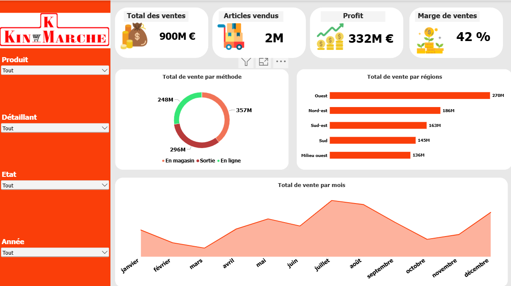

# Tableau de Bord Commercial et Rentabilité_Kin-Marché

## Présentation du Projet
Ce projet présente un tableau de bord analytique et financier réalisé sous **Power BI** pour l'enseigne **Kin-Marché**. 

L'objectif principal est de piloter l'activité commerciale globale en analysant le chiffre d'affaires, les volumes d'articles vendus, la rentabilité générée (profit et marge) ainsi que les canaux de distribution et la répartition géographique des ventes.

---

##  Aperçu du Tableau de Bord

---

##  Indicateurs Clés & Analyses

* **Performance Financière & Volumes :**
  * **Total des ventes (CA) :** **900 M€**.
  * **Volume d'articles vendus :** **2 Millions d'unités**
  * **Profit généré :** **332 M€**.
  * **Marge de ventes globale :** **42 %**.

* **Analyse par Canaux de Vente (Méthode) :**
  * Répartition des ventes selon le mode d'achat (En magasin, Sortie, En ligne) avec une part prédominante des ventes physiques et en ligne[cite: 2].
  * Répartition budgétaire par canal : 357 M€, 296 M€ et 248 M€.

* **Analyse Régionale :**
  * Suivi des ventes par zone géographique : la région **Ouest** est en tête avec **270 M€**, suivie du Nord-est (186 M€), du Sud-est (163 M€), du Sud (145 M€) et du Milieu ouest (136 M€).

* **Saisonnalité & Évolution Mensuelle :**
  * Graphique d'aire (*Area Chart*) retraçant la courbe des ventes sur l'année, mettant en évidence les pics d'activité sur la période estivale (juillet - août) et en fin d'année (décembre).

* **Interactivité & Filtrage Amélioré :**
  * Panneau latéral de filtres croisés permettant d'affiner l'analyse par **Produit**, **Détaillant**, **État** et **Année**.

---

## Stack Technique & Compétences Mobilisées

* Power BI Desktop :
  * Conception d'une interface utilisateur (*UI/UX*) personnalisée et alignée sur la charte graphique de la marque Kin-Marché.
  * Utilisation de cartes KPI visuelles, graphiques en anneau, diagrammes en barres et graphiques d'aire.
* **DAX & Modélisation :**
  * Définition de mesures calculées pour évaluer la marge nette (%), le profit global et le volume de ventes.
* Data Transformation (Power Query) :
  * Structuration et harmonisation des données de ventes, produits et régions.
 
  * ---
## 📂 Autres Réalisations
* 📊 **[Rapport de Ventes Interactif — US](https://github.com/pakyendou/nom-du-depot-analyse-ventes)** : Suivi du chiffre d'affaires (172 M€), des volumes et analyse cartographique des ventes aux États-Unis.
